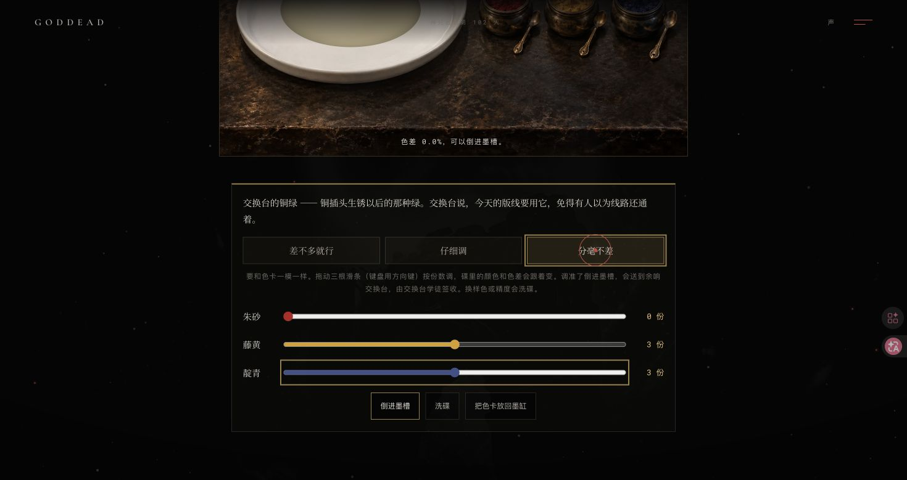
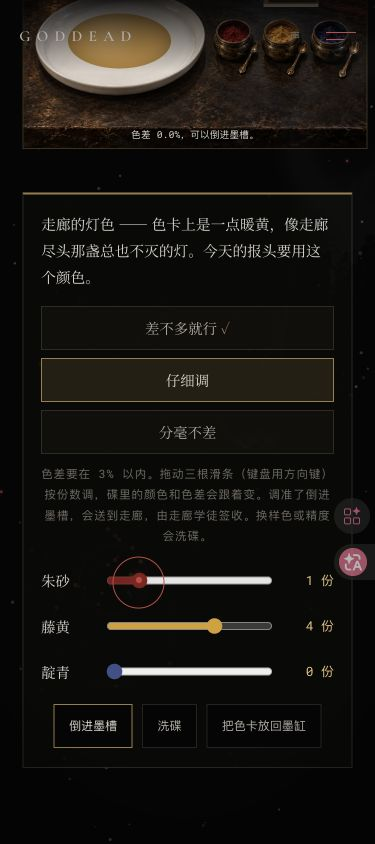

# v125 调墨房纯规则验收

2026-10-11，Chrome 原生鼠标 / 方向键 / Enter，桌面 1470×779 与窄屏 375×844。本轮迁移维护模块，画面与玩法保持；窄屏是桌面 Chrome 视口验收，不是手机硬件或真实触屏。

## 代码与独立规则

迁移前留存 v124 HEAD `11717f3dab934837f33bec68019fbe74154ecbd2` 的原十二函数，完整块 SHA-256 `1d3457a93d096e031bc28b2391043fd7bc64554dbd659ce46e92cb866961031f`。新文件移出两格缩进后的函数块完全相同；主脚本替换该块为配置工厂调用后的其余源逐字一致，原故事表只保留在主脚本。

343 个 0–6 份组合与旧版 RGB / 色差 / 三精度接受判定完全一致；另用纸 / 颜料质量合并后一次除法独立推导全部 RGB、平方和距离。三缸的粗 / 仔细 / 精确可行组合数为 `[4,1,1] / [59,18,2] / [44,12,4]`，保持原难度。63 份旧版 canonical 存档快照、归一化幂等、边界输入、新对象、配置隔离 / 深冻结输入、七类 pending 的 66 项缺字段 / 改值检查、额外字段和资格条件通过。

`node tests/site.test.mjs` 37,845 断言；`node --test tests/v101*.test.mjs tests/v102*.test.mjs tests/v103*.test.mjs tests/v104*.test.mjs` 65/65。实际模块分别加载于原 v107 集成及 v124 多章 VM；没有用假规则替换。模块不依赖 DOM / 存储 / 定时器，单独空 VM 能加载。`node --check` 主脚本 / 新模块 / 目录，以及 `git diff --check` 通过。

## 原生玩法

本地专用存档由已验证的 v63–v106 实际章节状态重建，v107 从默认空档开始，未伪造三次调色或裁定。最初基线缺老主线任命 / 焚献，旧金倒墨被原遗物科 guard 回退并取消；补齐原碎片 / 第四线路 / 退件 / 拒绝注销 / 任命 / 焚献字段后完整重载，继续同一份原生 v107 进度。原 guard 不改写、不旁路。

- 下一步原入口进调墨房，空碟色差 34.5%；点击未匹配倒墨不生成 pending / 记录。方向键 1/4/0 混出灯色，换精度与洗碟归零，草稿样色保留。
- 刷新碟前重置内存颜料并保留样色 / 精度。正确配方双击倒墨只创建一个 pending，刷新源房自动重播，走廊抵达 / 再刷新只记一份，学徒签收返回原房。
- 2/3/1「仔细调」旧金实际抵达遗物科，0/3/3「分毫不差」铜绿实际抵达交换台；各自原学徒文案与返回正常。鼠标将铜绿的朱砂拖至 2 后色差 5.9%，拖回 0 则 0.0%。滑条输入不写存档中的颜料份数。
- 原生完成三种样色 / 三档覆盖后开放首色听证。依次原生裁定黑白 / 留色 / 洇开，分别抵达 threshold / remembrance / unending-gallery；最终 mixRuns=3、courtRuns=3、三项裁定，下一步 v108。原借光入口可进入借光司。
- 窄屏目录搜索调墨房、原链接抵达；真实拖动红 1 / 黄 4 / 靛 0，色差 0.0%。精度按钮上下堆叠、全部滑条 / 倒墨 / 洗碟 / 放回可见并能滚到；根与场景宽均 375，无横溢。刷新颜料归零，放回保留三份收集 / 三裁定。
- v106 默认边界 + 陈旧完整 v107 raw 的调色碟深链回痕迹室，下一步 v106、调墨入口隐藏，旧 v107 raw 逐字不变。另用原规则生成合法 pour pending，在无关房间冷载后取消且 mixRuns=0。

部分批量输入紧贴转场 / 初载时，第一下尚未落定：以真实 DOM 份数为准重新在稳定页面输入并验证后才倒墨。一次实际 1/3/0（色差 6.3%）的双击被正确拒绝；不把未发生的 pending 写成验收成功。所有后续原生动作核对 active 场景、过场遮罩与实际存档后继续。

原 21 项本地 raw 精确恢复、mismatch / unexpected 均空；临时视口复原，无新增 error / warn。审计见 [v125-storage-audit.json](v125-storage-audit.json) / [v125-source-audit.json](v125-source-audit.json)。原始本地 fixture 与详细状态保留在忽略目录 `.v125-gemini/`，公开报告只记测试合同和结果。

## 公开发布

待 main 功能推送后核对 Pages、普通公开 URL 的 HTML / CSS / 主脚本 / 目录 / ink-rules / 原门图 / 三张 v107 原画字节，以及公开 Chrome 初载和原目录焦点 / 存储。
