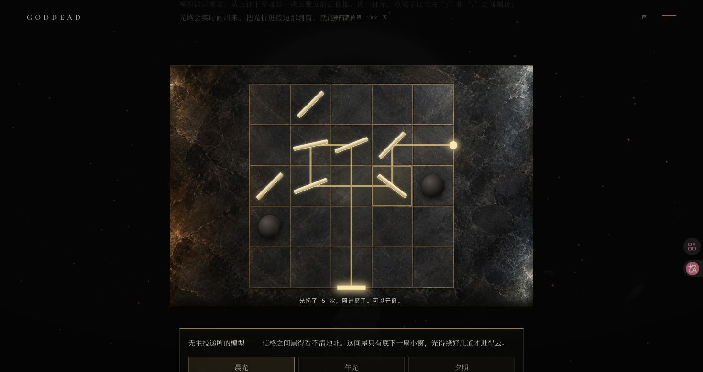
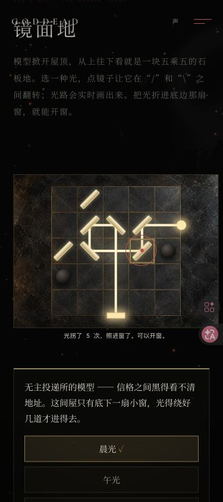

# v126 借光司纯规则验收

2026-10-11，Chrome 原生鼠标与 Enter，桌面 1470×779、窄屏 375×844。窄屏为桌面 Chrome 视口测试，不代表手机硬件或触屏。本轮维护规则模块，原画和玩法保持。

## 源码与独立规则

迁移前基线为 v125 HEAD `88f894081cdefe4a99658b0f3a442cc14073d5d7`。冻结原十二函数完整块 SHA-256 `b7e0e77e870f2c553c4ff21586c28fbc559fb386491f33b16545a17e3ea6348a`，移除新模块额外两格缩进后完全一致。主脚本仅将该块替换成配置工厂调用，其余源逐字保持；故事表仍一份，`ink-rules.js` 字节保持。新 `light-rules.js` 为 8,906 bytes，可在空 VM 加载，无 DOM / 存储 / 网络 / 定时器依赖，工厂与 API 冻结。

全部 `(2^7 + 2^6 + 2^8) × 3 = 1,344` 组镜面结果逐项对照旧 path / exit / bounces / blocked / lit / SVG points。独立算法以 N/E/S/W 方向和两张反射表追踪，另按格心 / 边沿计算坐标；覆盖两种镜朝向 × 四种入射方向。九阵解数与最少翻镜如下，初阵全部未亮。

| 模型 | 晨光 解数 / 最少翻镜 | 午光 | 夕照 |
| --- | --- | --- | --- |
| 投递所 | 4 / 4 | 8 / 3 | 4 / 3 |
| 注销科 | 8 / 2 | 4 / 3 | 8 / 3 |
| 守则厅 | 8 / 4 | 16 / 4 | 8 / 3 |

63 份旧版 canonical 存档完全一致、归一化幂等；默认十一字段、新对象与输入深冻结、计数界限、开庭覆盖、九种结果文案通过。七类 pending 各有合法样本，66 项缺字段 / 改值、额外字段、活动签收 / 草稿 / 开庭资格拒绝通过。另一工厂 N=100 / version=999 验证 80 步上限和配置隔离，原 N=5 / version=108 保持。

`node tests/site.test.mjs` 43,375 断言；`node --test tests/v101*.test.mjs tests/v102*.test.mjs tests/v103*.test.mjs tests/v104*.test.mjs` 65/65。原 v108 及 v124 多章 VM 实际载入新模块，无规则补桩。主脚本 / 两规则 / 目录 / 测试语法、diff、280 场景 / 4501 唯一 ID / 278 原目录字节 / 原存档键 / 引用 / 敏感标记检查通过。

## 原生游玩

本地专用基线使用上一版实际原生完成的 v107 三配方 / 三精度 / 三签收 / 三听证，及已验证的上游章节和原主线字段；v108 从默认空档开始。原 guard 不改写，借光与听证都由真实按钮完成。

- 指引找到借光入口，进入投递所模型晨光。初阵石柱挡光，2 折 / 0 翻；暗窗点击没有事务或收集，空地和石柱禁用。实际 SVG points 与旧 oracle 一致，翻镜的 aria 朝向与状态同步。
- 翻 6 / 7 / 11 / 13 格，晨光五折照进底窗。切午光回初阵，切回晨光重新翻；刷新保留模型 / 光种，镜面回初阵。复原按钮回初阵。每步 DOM 折线和亮窗与旧快照一致。
- 解阵双击开窗只生成一次 shine pending，在途全部镜格和开窗禁用。刷新源房显示原反馈并自动重播，真实抵达投递所只记一束；再刷新目标仍 beamRuns=1，原投递点灯人返回借光司。
- 注销科午光翻 13 / 17 / 18 格，四折亮窗；守则夕照鼠标翻 13 / 17 / 18 格，五折亮窗。旧折线均一致，分别由原注销点灯人 / 守则点灯人签收；beamRuns=3，三模型和三光覆盖。
- 听证原生选择「每扇窗都打开」「给神留一间暗屋」「让光回去」，依次抵达原 threshold / remembrance / unending-gallery；courtRuns=3、三裁定完整。痕迹室下一步 v109，原分茶入口实际进入 `exact-tea-house`，三个订单正常。
- 375px 原目录回借光司 / 投递所模型，鼠标四翻亮窗。全部 localStorage raw 前后逐项相同，镜面只在内存；格子 44.125×43.375px，视口 / 根 / 场景 clientWidth 与 scrollWidth 均 375。刷新镜面回初阵，三收集 / 三裁定和草稿仍在；下方复原 / 盖屋顶真实点击成功，盖屋顶回借光司且收集保持。
- 合法 v107 墨学徒活动记录下，借光入口显示但禁用，原提示等待色样签收，下一步优先 v107。v107 默认空档 + 陈旧完整 v108 raw 下，镜面地深链回痕迹室、借光图鉴隐藏、下一步 v107，原 v108 raw 字节不变。
- 用原构造器生成合法 shine pending，无关守则厅冷载取消，beamRuns=0、没有收集，不误当成抵达。

原 21 项本地 raw 精确恢复，mismatch / unexpected 均空；临时视口复原、4173 服务停止且 curl 拒连，无新增 error / warn。明细见 [v126-storage-audit.json](v126-storage-audit.json) / [v126-source-audit.json](v126-source-audit.json)。原始 fixture / 全部 DOM 状态在忽略目录 `.v126-gemini/`，公开报告仅记合同与结果。

## 公开发布

待推送后核对 Pages、普通公开十文件原始字节，以及新工厂冷载 / 首页 / 原目录 / 焦点 / 存储。发布结果随后补记。
