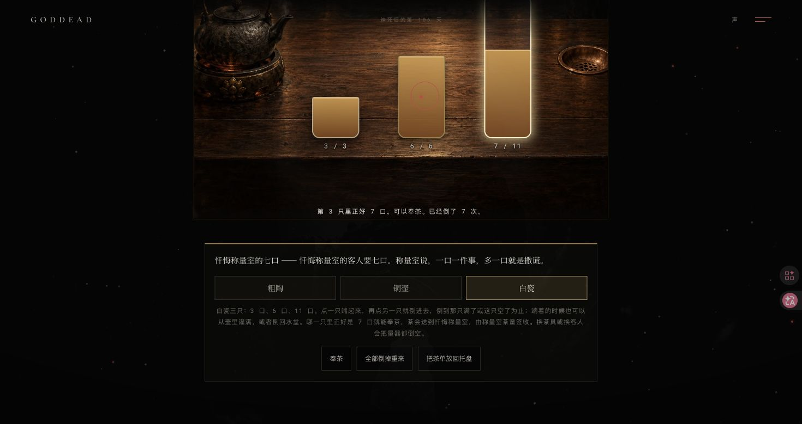
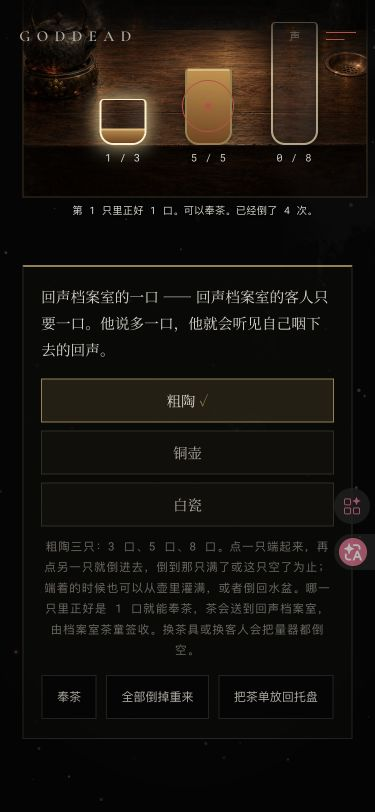

# v127 分茶铺规则迁移：本轮浏览器验收

日期：2026-10-15（Asia/Taipei）。范围为继续检查已经存在的 v127 工作区，不把本轮复核误记为新剧情或原迁移代码的作者证明。

## 工具、模型与边界

- 使用 Chrome Computer Use 原生 AX 点击；同一时间只有一张 QA 标签页。前次中断自动关闭的 80235077 被 80235083 替代，未操作用户其他标签页。
- 用户确认改用 `gemini-3.8-flash-high`。本轮第一次请求因 TLS handshake timeout 终止；精简后的同模型复核成功（`resp_N2nQapDFN6rSrfcPqoWRmQQ`），结论为未发现实质缺陷。它不替代独立测试与浏览器验收，也不证明既有迁移由本轮 Gemini 编写。
- 本版无新增美术，沿用三张 v109 原画；本轮桌面与窄屏截图见下方。
- 本地存档、事务捕获和模型原始输出保存在忽略目录 `.v127-gemini/`，不将完整玩家存档公开提交。

## 原生交互与事务

1. 白瓷给忏悔者量 7 口，逐步观察 `[0,0,11] → [3,0,8] → [3,6,2] → [3,0,2] → [3,2,0] → [3,2,11] → [3,6,7]`。每步重新端起量器，实际 AX 口数均与独立路线一致。
2. 原生双击奉茶，捕获真实 source `pouring-table` 的 serve pending 与三杯 disabled。在途硬刷新后到 `confession`，白瓷 7 口收据可见，pourRuns 从 2 到 3；目标房再刷新仍为 3。茶童返回分茶铺并清除 activeServer。
3. 泥陶给回声者量 1 口，实际四步 `[3,0,0] → [0,3,0] → [3,3,0] → [1,5,0]`，奉茶到 echo 后签收返回。
4. 铜器给血管者量 4 口，换茶具后量器清空，实际三步 `[0,0,11] → [2,0,9] → [2,5,4]`，奉茶到 vein 后签收返回。
5. 三个听证按钮分别实际抵达 threshold、remembrance、unending-gallery，依次新增三个不同结局。最终唯一订单 3 个，累计 pourRuns 5（原存档已有 2），唯一听证 3 个，courtRuns 3。
6. 痕迹页下一步变为 v110 扫尘司；实际点击 `sw-entry-btn` 抵达 `sweeping-office`，可见三个房间按钮。
7. 从真实订单按钮捕获 order pending，冷导航到非目标 threshold，确认 pending 取消，次数与收藏均未增加。
8. 前一连续检查阶段已实际检查空杯拒奉、量器端起/放下与刷新清空；本轮换具和重新加载再次观察到量器不保存。

## 门禁 fixture 与保留边界

- 仅将备份中的 v108 `activeLamplighter` 设置为已收集的合法 beam，冷载痕迹页，观察下一步“等待签收”、分茶铺主入口 `et-entry-btn` disabled 及具体等待提示。该 fixture 不是完整原生游玩 v108 的证明；`et-court-entry-btn.disabled` 为 false，未将结论扩写为全部入口禁用。
- 临时移除已有备份的 v108 键后，分别冷载 exact-tea-house、pouring-table、hearing-of-the-last-cup，三者均退回 remembrance；分茶铺已有 raw 存档不变。
- 没有使用 `localStorage.clear()`。正常流程中，除主状态和 v109 茶状态之外，原有键均未改变；只新增了实际进入 v110 后的 `goddead_v110_last_sweep`。

## 视觉与清理

- 375 × 812 为桌面 Chrome 视口模拟，并非手机硬件或触屏验收。原生完成泥陶与铜器操作；document/body 宽均为 375，没有横向溢出，最小铜器高度 44px；茶台原图自然尺寸 1536 × 1024。
- 桌面恢复为原始 1470 × 779。本轮原始快照有 56 个键，与旧 21 键快照不同，恢复只使用新的 56 键 raw。
- 所有 56 个原始值逐字恢复，仅移除本轮新增且原快照不存在的 v110 测试键；恢复原 URL `http://127.0.0.1:4173/`，重新加载后再次核对 56 个键全部 byte-exact、无额外键。
- 一次恢复后的 CDP 硬刷新遇到浏览器工具 paused response，使用同标签页普通 reload 恢复；随后实际观察首页、56 键一致及原视口。没有持久 cache override。
- 本轮读取的浏览器 warn/error 日志为空；本地服务器观察到既有 favicon.ico 404，因此不称“所有资源零错误”。
- 本轮临时 Python 服务 PID 38810 已停止，4173 无监听。

## 自动化检查与发布边界

- 全站测试：68,927 个断言通过。
- 历史 v101–v104 的 65 个命名测试与 v123–v127 的 5 个脚本入口，共 70 tests / 70 pass / 0 fail。
- v127 独立检查：768 个合法口数状态、6,912 个源/目标组合转移、2,304 个匹配、36 个最短路目标、63 个 canonical 样本和 66 个严格 pending 检查。
- 原纯规则块去除新增缩进后与迁移前 `220b1ae81579ab502c9f7841e82aa4ae643b8ab9` 一致，主脚本块外字节一致；场景 280、ID 4501、原目录 278 保持，原 ink/light 模块和源码存档键集合保持。
- 本记录写入时公开发布尚未进行。随后 Gemini 3.8 Flash High 的工程文档请求及一次缩短请求均以 TLS handshake timeout 退出，没有完整文档产物；七份工程文档仍未改动，本轮未提交或推送。独立只读模型复核成功与这两次文档连接失败是不同请求。
- 唯一 QA 标签页随后转到普通 `https://goddead.com/`，当前仍加载 v126。仅记录公开存档基线，未注入测试数据；结束时公开 origin 的 1 项 raw 与读取基线一致。该观察不是 v127 公开验收。
- 续接顺序：同一已批准模型完成七份工程文档同步，审阅差异并定向暂存，通过发布门禁后推送 main，再核对 Pages / 普通公开资源 / 浏览器，最后补齐发布事实。公开提交与结果以真实后续记录为准。

## 2026-10-18 续接复核

- 再次实际运行 `node --check script.js`、`node --check tea-rules.js`、`node tests/site.test.mjs`，全站仍为 68,927 个断言通过；显式运行 v101–v104 与 v123–v127 的 `node --test`，仍为 70 tests / 70 pass / 0 fail。
- `script.js` / `index.html` / `tea-rules.js` SHA-256 分别为 `b95158bb9aed486a7a1b6a4098aec7ac31c410a61087e52c6139ddf08cc8769b` / `09cd5fbcd4686449432ecf0b0313fe352278e510bb10b19c65a633984034b800` / `cd21a59b7c95edc9c2da80f3cf355ecd802277ee89a528615f70225d4125a5a4`，与 10 月 15 日完成本地原生交互时一致。这次自动化重跑不虚构为再次完成整套浏览器流程。
- 旧 QA 标签页已不在 Chrome 当前列表；仅查看标签页清单，没有操作用户其他网页，也没有提前新开验收窗口。
- 后续「余温温室」的设计、原画与隔离纯规则原型请求不属于 v127，不纳入本版生产源码、资源或提交；原型请求最终也未返回完整代码。
- 当日 `gemini-3.8-flash-high` 列表检查成功；工程文档首请求以 read timeout 结束，缩短请求成功返回 11 项完整操作（`resp_6izUauiaLIn71e8P0quayAo`）。其中四项需纠正验收范围、主脚本职责及作者 / 日期 / 发布边界，未应用；原成功稿与七项可用操作保存在忽略目录，避免丢失已收到产物。
- 完整纠错请求与仅四项操作的精简纠错请求均已真实以 read timeout 结束；没有挂起的文档请求。本轮停止追加文档重试，七份工程文档仍保持原字节，尚未提交、推送或进行 v127 公开验收。后续可以仅向同一批准模型修正四项，其余七项原样复用，不能用根代理手写修补冒充 Gemini 产物。

## 2026-10-22 发布前复查

- 中断后的请求已检查：没有遗留运行中的 CPA 进程。10 月 18 日已收到合格的 Tasks、ProgressLog、v109 附录及路线图修正；最后缺失的 GameplayFlow 单段于本日由同一 `gemini-3.8-flash-high` 返回（`resp_KbXZaonUIvXgrfcPnsqIiAQ`）。十一项完整操作按原文机械应用，工程文档不含根代理手写改稿；原历史段落保留。
- 本日再次完成语法检查、68,927 条站点断言与 70/70 测试。独立只读审查确认 11 个规则函数去掉新增缩进后原字节一致，主脚本适配之外不变；三项源码 SHA 与 10 月 15 日原生验收记录一致。没有把本日静态复跑写成重新游玩整套流程。
- 重新核对 280 场景、4501 ID、278 条原目录及存档键；重复 ID、无效 hash、本地引用缺失和源文件敏感标记均为零。敏感扫描还须在定向暂存后覆盖全部待提交文本。
- 仅打开一张 Chrome 公开 QA 标签页，发布前实际观察到 v126；公开 origin 原始 1 项存档只在工具会话中留存比对，没有注入测试数据。
- “余温温室”仍是独立的未来玩法工作，不纳入本次提交。发布结果与普通公开资源 / 浏览器检查另记，以上记录本身不证明已经上线。
